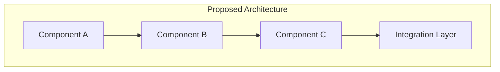

# {Feature Name} - Design Document

| Status | Author        | Date   | Jira Epic                                                    |
| ------ | ------------- | ------ | ------------------------------------------------------------ |
| Design | {Author Name} | {Date} | [{EPIC-KEY}](https://sanofi.atlassian.net/browse/{EPIC-KEY}) |

**Goal:** {One-line goal statement}

---

## Executive Summary

{Brief overview of the feature, what problem it solves, and the high-level approach. 2-3 paragraphs that a non-technical stakeholder can understand.}

---

## Problem Statement

### Current State

{Description of how things work today and why that's insufficient.}

### Gaps & Limitations

| Area     | Current State | Gap              |
| -------- | ------------- | ---------------- |
| {Area 1} | {What exists} | {What's missing} |
| {Area 2} | {What exists} | {What's missing} |

---

## Proposed Solution

### High-Level Architecture

_Replace with actual architecture showing key components and their relationships._

### Key Components

| Component     | Purpose                |
| ------------- | ---------------------- |
| {Component 1} | {What it does and why} |
| {Component 2} | {What it does and why} |
| {Component 3} | {What it does and why} |

### Integration Approach

{Description of how this solution integrates with existing systems. Focus on the "what" and "why", not the "how".}

---

## Implementation Phases

### Phase 1: {Phase Name}

**Goal:** {What this phase achieves}

**Deliverables:**

- {Deliverable 1}
- {Deliverable 2}

### Phase 2: {Phase Name}

**Goal:** {What this phase achieves}

**Deliverables:**

- {Deliverable 1}
- {Deliverable 2}

### Phase 3: {Phase Name}

**Goal:** {What this phase achieves}

**Deliverables:**

- {Deliverable 1}
- {Deliverable 2}

---

## Cost Considerations

| Category     | Estimated Impact              | Notes     |
| ------------ | ----------------------------- | --------- |
| {Category 1} | {Low/Medium/High or $X/month} | {Context} |
| {Category 2} | {Low/Medium/High or $X/month} | {Context} |

---

## Risks & Mitigations

| Risk     | Impact         | Mitigation             |
| -------- | -------------- | ---------------------- |
| {Risk 1} | {Impact level} | {How we'll address it} |
| {Risk 2} | {Impact level} | {How we'll address it} |

---

## Success Criteria

How we'll know this is successful:

- {Business/user-facing success metric 1}
- {Business/user-facing success metric 2}
- {Business/user-facing success metric 3}

---

## References

- [{Reference 1}]({url})
- [{Reference 2}]({url})

---

## Local Documentation

This design document is also maintained in the codebase:

- **Design Doc:** `docs/epics/{epic-key}-{feature-name}-design.md`
- **Refinement Doc:** `docs/epics/{epic-key}-{feature-name}-refinement.md`

---

_For technical implementation details, see the linked Jira epic and associated tasks._
