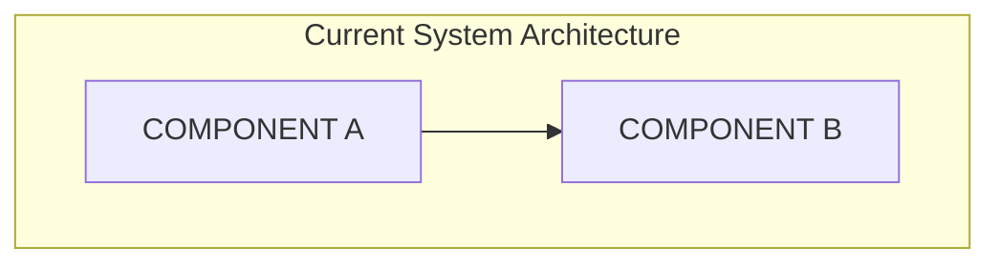
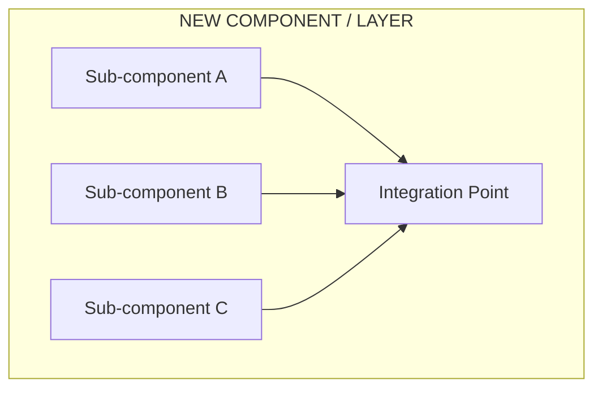
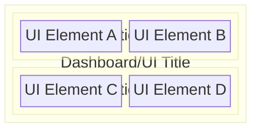

# {Feature Name} Design Document

> **Status**: Design Document  
> **Author**: {Author Name}  
> **Date**: {Date}  
> **Goal**: {One-line goal statement}

---

## Table of Contents

1. [Executive Summary](#executive-summary)
2. [Current Architecture Analysis](#current-architecture-analysis)
3. [Problem Statement](#problem-statement)
4. [Solution Architecture](#solution-architecture)
5. [Implementation Phases](#implementation-phases)
6. [Detailed Design](#detailed-design)
7. [Cost Considerations](#cost-considerations)
8. [Risks & Mitigations](#risks--mitigations)
9. [Success Metrics](#success-metrics)
10. [References](#references)

---

## Executive Summary

{Brief overview of the feature, what problem it solves, and the high-level approach. 2-3 paragraphs.}

---

## Current Architecture Analysis

### Components Under Observation



### Current Gaps / Limitations

| Aspect     | Current State     | Gap              |
| ---------- | ----------------- | ---------------- |
| {Aspect 1} | {What exists now} | {What's missing} |
| {Aspect 2} | {What exists now} | {What's missing} |

---

## Problem Statement

### Functional Requirements

1. **{Requirement Category 1}**
   - {Specific requirement}
   - {Specific requirement}

2. **{Requirement Category 2}**
   - {Specific requirement}
   - {Specific requirement}

### Non-Functional Requirements

- **{NFR 1}**: {Description with measurable target}
- **{NFR 2}**: {Description with measurable target}

---

## Solution Architecture

### High-Level Design



### Integration Strategy

| Layer  | Tool/Approach | Purpose        |
| ------ | ------------- | -------------- |
| **L1** | {Tool/Tech}   | {What it does} |
| **L2** | {Tool/Tech}   | {What it does} |
| **L3** | {Tool/Tech}   | {What it does} |

---

## Implementation Phases

### Phase 1: {Phase Name} (Week 1-2)

**Goal**: {What this phase achieves}

- [ ] {Task 1}
- [ ] {Task 2}
- [ ] {Task 3}

### Phase 2: {Phase Name} (Week 3-4)

**Goal**: {What this phase achieves}

- [ ] {Task 1}
- [ ] {Task 2}
- [ ] {Task 3}

### Phase 3: {Phase Name} (Week 5-6)

**Goal**: {What this phase achieves}

- [ ] {Task 1}
- [ ] {Task 2}
- [ ] {Task 3}

---

## Detailed Design

### {Section 1 Name}

{Description of this component/feature}

#### Code Location

| File                | Purpose             |
| ------------------- | ------------------- |
| `{path/to/file.ts}` | {What changes here} |
| `{path/to/file.ts}` | {What changes here} |

#### Implementation Details

```typescript
// {path/to/file.ts} (conceptual changes)

{Code snippet showing the key implementation pattern}
```

### {Section 2 Name}

{Description of this component/feature}

#### Code Location

| File                | Purpose             |
| ------------------- | ------------------- |
| `{path/to/file.ts}` | {What changes here} |

#### Implementation Details

```typescript
// {path/to/file.ts} (conceptual changes)

{Code snippet showing the key implementation pattern}
```

### {Optional: Dashboard/UI Mock Preview}



_Note: For complex UI mockups, consider using Figma or a dedicated wireframing tool otherwise ASCII representation of UI/dashboard elements_

---

## Cost Considerations

### {Cost Category 1}

| Component | Estimated Cost | Notes                |
| --------- | -------------- | -------------------- |
| {Item 1}  | {Cost/month}   | {Additional context} |
| {Item 2}  | {Cost/month}   | {Additional context} |

**Estimated Total**: {Amount}/month ({environment})

### Cost Optimization Strategies

1. {Strategy 1}
2. {Strategy 2}
3. {Strategy 3}

---

## Risks & Mitigations

| Risk     | Impact               | Mitigation        |
| -------- | -------------------- | ----------------- |
| {Risk 1} | {Impact description} | {How to mitigate} |
| {Risk 2} | {Impact description} | {How to mitigate} |
| {Risk 3} | {Impact description} | {How to mitigate} |

---

## Success Metrics

### Phase 1 Success Criteria

- [ ] {Measurable criterion 1}
- [ ] {Measurable criterion 2}
- [ ] {Measurable criterion 3}

### Phase 2 Success Criteria

- [ ] {Measurable criterion 1}
- [ ] {Measurable criterion 2}
- [ ] {Measurable criterion 3}

### Overall Success Criteria

- [ ] {High-level success metric 1}
- [ ] {High-level success metric 2}

---

## References

- [{Reference 1 Title}]({url})
- [{Reference 2 Title}]({url})
- [{Reference 3 Title}]({url})

---

## Appendix A: {Optional Appendix Title}

{Additional details, example data structures, configuration references, etc.}

## Appendix B: {Optional Appendix Title}

{Environment variables, checklist, etc.}
